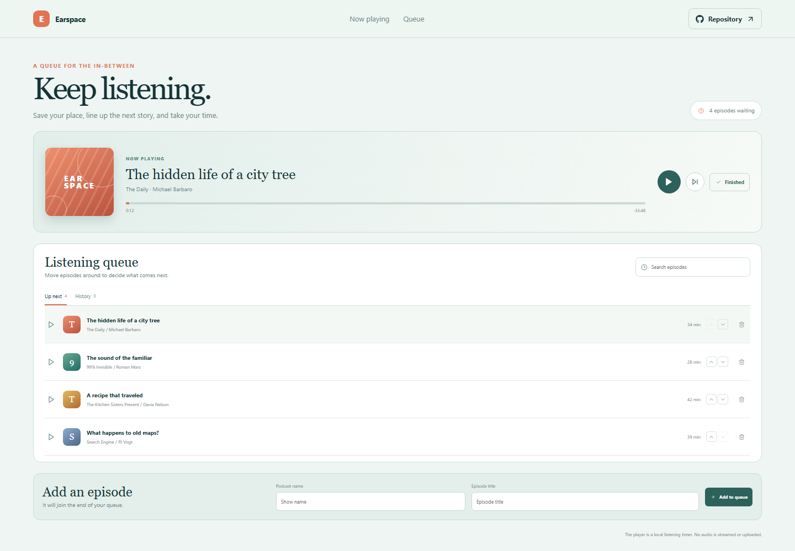

# Podcast Queue Manager

Earspace organizes podcast episodes into a listening queue so it is easy to resume an episode and decide what should play next.

**Live site:** [https://a2rp.github.io/podcast-queue-manager/](https://a2rp.github.io/podcast-queue-manager/)

## Interface

A now-playing panel displays the selected episode, a local progress timer, and playback controls. The queue panel includes Up next and History views, search, reorder actions, and an add form.

## Features and use

Select Play beside an episode or use the player controls. Move upcoming episodes with the arrow buttons. Select Finished to move the current episode into History. Add a show and episode title to place a new episode at the end. Remove an episode with the trash button and confirm. The timer is a local demo and no audio is streamed.

## Data and limits

Episodes, queue order, and listened status are saved in localStorage. Timer progress is saved with each episode. The app does not connect to a podcast service.

## Run locally

Use Node.js and npm, then run these commands from the project folder:

```sh
npm install
npm run dev
```

Run ESLint and create a production build with:

```sh
npm run lint
npm run build
```

## Deployment

The public app is published with GitHub Pages. Build and publish the current version with:

```sh
npm run deploy
```

Vite builds with the /podcast-queue-manager/ project-page base path.

## Future improvements

These are ideas and are not implemented yet:

- Connect to podcast feeds and stream user-selected episodes.
- Add playback speed, sleep timer, and subscription management.

## Links

- Portfolio: [https://www.ashishranjan.net](https://www.ashishranjan.net)
- GitHub: [https://github.com/a2rp](https://github.com/a2rp)
- CodePen: [https://codepen.io/ash1198](https://codepen.io/ash1198)
- LinkedIn: [https://www.linkedin.com/in/aashishranjan](https://www.linkedin.com/in/aashishranjan)
- Facebook: [https://www.facebook.com/theash.ashish/](https://www.facebook.com/theash.ashish/)
- YouTube: [https://www.youtube.com/@ashishranjan-ashz?sub_confirmation=1](https://www.youtube.com/@ashishranjan-ashz?sub_confirmation=1)
- Email: [mailto:ash.ranjan09@gmail.com](mailto:ash.ranjan09@gmail.com)

## Support

- Support: [https://a2rp-donation-page.netlify.app/](https://a2rp-donation-page.netlify.app/)
- Buy Me a Coffee: [https://buymeacoffee.com/ashishranjan](https://buymeacoffee.com/ashishranjan)
- Patreon: [https://www.patreon.com/ashishranjan](https://www.patreon.com/ashishranjan)